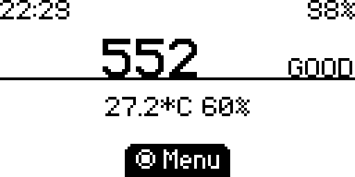
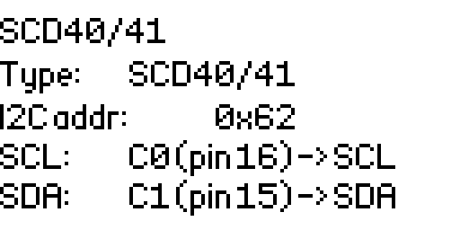

# SCD40/41 investigation and validation

## Result and scope

An SCD41 connected to a Flipper Zero produced changing CO2, temperature, and
humidity readings using the existing SCD40 driver's periodic measurement commands.
The device ran Momentum **mntm-009CN**, reporting **API 79.2**, and the app was
built with the matching mntm-009 SDK. Validation took place on October 16–17, 2026.

The UI now calls this shared driver **SCD40/41**. Its persisted type identifier
remains `SCD40`, and the existing PWM/UART setting values remain 0 and 1; the
new SCD40/41 choice uses 2. Existing sensor configuration files remain readable.

This was a functional check of periodic measurements. SCD40 hardware, single-shot
mode, calibration accuracy, long-term drift, and extended stability were not
verified. Official firmware was build-checked only; no runtime test was performed
on official firmware during this investigation.

## How the issues were found

1. An SCD41 was available, and the initial question was whether the inherited
   SCD40 driver could read it without implementing a separate protocol.
2. Source inspection found SCD40 registered in the sensor table, but the climate
   selector excluded all CO2 types and the CO2 selector offered only PWM/UART.
   Merely compiling the original app therefore did not expose the driver to users.
3. Sensirion's shared SCD4x datasheet confirmed that SCD40 and SCD41 use the same
   commands and response layout for periodic measurements. The original update
   callback also ignored read failures and always returned success. It polled
   every second even though new measurements arrive about every five seconds.
4. Building against the installed mntm-009 SDK exposed an I2C handle qualifier
   difference: that SDK takes mutable bus handles, while newer SDKs use const
   handles. The Makefile also referenced the old `co2_app` target and a developer's
   absolute macOS output path. These prevented reproducing the build as documented.
5. After adding the selector and readiness/error handling, a connected SCD41
   produced changing readings on the device. An initial 12-second screen capture
   showed CO2 changing from **1055 to 1057 ppm**, temperature **25.0–25.1 °C**,
   and humidity **70–71% RH**. A separate seven-second error-log observation
   showed no I2C or CRC error messages.
6. The tester reported that **C1 → SDA and C0 → SCL** worked, opposite to the
   README and app's Info screen. Checking the official pinout and Momentum's
   hardware I2C configuration confirmed that the instructions were reversed.
   Both README variants and the Info screen were corrected. The hardware bus
   pin assignment already matched the working connection.
7. The Info screen still described the shared driver as `SCD40`. An `altname`
   of `SCD40/41` now provides the display label while retaining the saved type ID.

The data-readiness, failure-return, and partial-update issues were found through
source inspection and simulated tests; no physical bus-fault injection was done.

## Correct wiring

For an SCD41 breakout that supports 3.3 V power and logic:

| Flipper Zero | SCD40/41 breakout |
|-------------|------------------|
| C1 / PC1, pin 15 | SDA |
| C0 / PC0, pin 16 | SCL |
| 3.3 V, pin 9 | VCC / VIN |
| GND, pin 8 | GND |

Check the breakout's supply requirements and keep SDA/SCL pull-ups at 3.3 V.
The sensor's 7-bit I2C address is **0x62**. The Flipper HAL uses the shifted
address **0xC4**, which is what `sensors.cfg` stores; the Info screen displays 0x62.

The same SDA/SCL correction applies to the BME280 documentation. UART also uses
pins 15/16, so the existing UART mode continues to disable separate I2C climate
sensors. SCD40/41 uses I2C and can share that bus with a climate sensor at a
different address.

## Measurement behavior

| Command | Value | Handling |
|---------|-------|----------|
| Stop periodic measurement | `0x3F86` | Stop a possible previous session; wait 500 ms before starting |
| Start periodic measurement | `0x21B1` | Start the shared periodic mode |
| Get data ready status | `0xE4B8` | Check the low 11 bits before reading |
| Read measurement | `0xEC05` | Read 9 bytes: CO2, temperature, humidity, each with its own CRC |

The app checks readiness once per second. A not-ready response returns `POLLING`,
preserves the last sample, and does not restart the sensor or reapply offsets/unit
conversions. I2C failures and invalid CRCs return an error. All three words must
pass CRC validation before any displayed sample field is replaced; a zero CO2
sample is rejected. A valid sample updates the last-valid timestamp.

On the main screen, SCD4x temperature/humidity are used when the separate climate
sensor has no valid data. The PWM-specific freeze/eject behavior is kept on the
PWM sensor so the five-second SCD4x measurement interval does not trigger it.

## Reproduce the build and device check

Use an existing uFBT installation and SDK state matching the installed firmware:

```sh
UFBT_HOME=/path/to/momentum-sdk-state FBT_TOOLCHAIN_PATH="$HOME/.ufbt" \
  make build UFBT=/path/to/ufbt
```

The output is `dist/air_stats.fap`. Upload it to `/ext/apps/GPIO/air_stats.fap`,
or run `make install` with the same environment to upload and launch through uFBT.
The binary is ignored by Git; build it for the target firmware's API.

1. Wire the sensor as above and open **Apps → GPIO → Air Stats**.
2. Choose **Menu → CO2 Sensor → Edit → CO2 Type → SCD40/41**.
3. Press Back to apply, then return to the main screen and allow at least five
   seconds for the first measurement.
4. Observe multiple measurement intervals and confirm CO2, temperature, and
   humidity change. The separate climate sensor must have no valid reading to
   see the SCD4x temperature/humidity fallback.
5. Open **Menu → CO2 Sensor → Info** and verify `Type: SCD40/41`, address `0x62`,
   `SCL: C0 (pin 16)`, and `SDA: C1 (pin 15)`.
6. Optionally observe `log error` from the USB CLI for several measurement
   intervals. Stop the log stream with Ctrl+C.

The uploaded binary's checksum matched the local build, and the USB CLI reported
that Air Stats was running. These are captured device screens, not mockups:

| Periodic measurement after correcting the instructions | Shared type and pin mapping |
|-------------------------------------------------------|-----------------------------|
|  |  |

The values above are examples of live output, not comparisons against a calibrated
reference instrument.

## Automated and build checks

```sh
python3 tools/test_scd4x.py
git diff --check
```

The host test compiles the production SCD40 driver against simulated platform and
I2C functions. It checks the stop/start sequence, 500 ms stop delay, address,
not-ready behavior, a fixed response for the datasheet's example values
(500 ppm, 25 °C, 37% RH) with CRCs per section 3.11, the independent
`CRC(0xBEEF) = 0x92` reference, each
measurement-word CRC failure, readiness CRC failure, zero CO2 rejection, and
I2C read/write failures. It checks that invalid measurement frames do not partially
replace the prior sample. This does not exercise physical wiring or the Flipper UI.

| SDK | Build result | Runtime result |
|-----|--------------|----------------|
| Momentum mntm-009, f7 API 79.2 | Passed | SCD41 periodic measurements and Info screen verified on mntm-009CN |
| Official 1.5.1, f7 API 88.2 | Passed | Not tested |

## References

- [Sensirion SCD4x datasheet, version 1.5](https://sensirion.com/media/documents/48C4B7FB/64C134E7/Sensirion_SCD4x_Datasheet.pdf): sections 3.5 (shared periodic commands), 3.8.2 (data readiness), 3.11 (CRC), and 3.4 (command timing).
- [Official Flipper Zero GPIO documentation and pinout](https://docs.flipper.net/zero/gpio-and-modules): PC1/pin 15 is I2C3 SDA and PC0/pin 16 is I2C3 SCL.
- [Momentum mntm-009 I2C configuration](https://github.com/Next-Flip/Momentum-Firmware/blob/mntm-009/targets/f7/furi_hal/furi_hal_i2c_config.c): external hardware I2C3 on PC0/PC1 and the SDK's mutable handle definitions.
